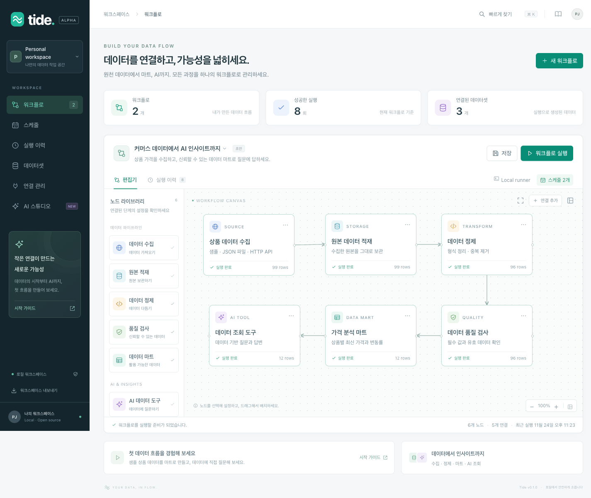
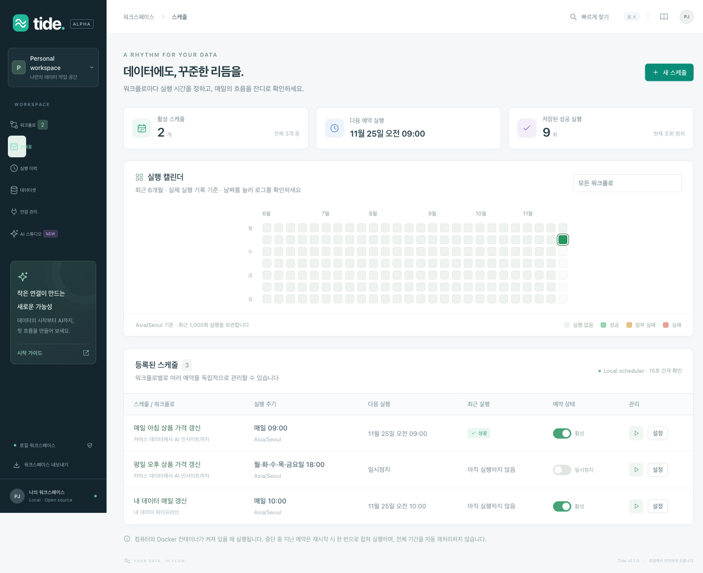

# Tide

[](https://github.com/p-junhyeok/tide/actions/workflows/ci.yml)


원천 데이터 수집, 정제, 품질 검사, 데이터 마트와 데이터 조회를 연결하는 로컬 워크플로 도구입니다. 시각적 편집기에서 흐름을 만들고, 스케줄로 실행 시간을 정하고, 캘린더에서 결과를 확인합니다. Docker Compose로 실행하며, 샘플 흐름에는 클라우드 계정이나 API 키가 필요하지 않습니다.

현재 버전은 상품 가격 데이터를 처리하는 첫 구현입니다. 시각적 편집기와 실제 실행 엔진을 연결했으며, 지원 범위는 [현재 구조](docs/architecture.md)와 [확장 계획](docs/roadmap.md)에 정리했습니다.



<details>
<summary>워크플로별 스케줄과 실행 잔디 보기</summary>



</details>

## Docker로 실행하기

Docker Desktop 또는 Docker Engine과 Docker Compose 플러그인이 필요합니다.

```bash
git clone https://github.com/p-junhyeok/tide.git
cd tide
docker compose up --build -d
```

[http://localhost:4318](http://localhost:4318)에 접속하세요. 상태와 서버 로그는 다음 명령으로 확인합니다.

```bash
docker compose ps
docker compose logs -f tide
```

4318번 포트를 사용 중이라면 호스트 포트를 바꿔 실행하세요.

```bash
TIDE_PORT=4320 docker compose up --build -d
```

변경한 경우 접속 주소는 `http://localhost:4320`입니다.

## 첫 데이터 흐름 실행하기

1. **워크플로**에서 준비된 상품 가격 흐름을 확인하세요.
2. **워크플로 실행**을 누르세요.
3. 실행 상세에서 단계별 성공 여부와 처리 건수를 확인하세요.
4. **데이터셋**에서 `raw.product_prices`, `staging.product_prices`, `mart.product_prices`를 선택하세요.
5. **AI 스튜디오**에서 `평균 가격은 얼마야?` 또는 `가격이 오른 상품을 알려줘`를 입력하세요.

샘플은 원본 99건을 읽습니다. 정제 단계에서 잘못된 레코드 1건과 중복 2건을 제외하고 96건을 남깁니다. 마트에는 상품별 최신 레코드 12건이 저장됩니다. 샘플 평균 가격은 42,083원이며, 답변에는 사용한 데이터셋과 갱신 시각이 함께 표시됩니다.

AI 스튜디오는 현재 지원하는 질문을 분류해 실제 마트를 계산하는 `Data tool` 모드입니다. LangGraph나 LLM을 호출하지 않습니다.

## 반복 실행 예약하기

1. **스케줄**에서 **새 스케줄**을 누르세요. 워크플로 편집기의 **스케줄 설정**으로도 시작할 수 있습니다.
2. 실행할 워크플로와 스케줄 이름을 입력하세요.
3. **매일** 또는 **요일 선택**을 고르세요. 요일 선택에서는 실행할 요일을 하나 이상 선택하세요.
4. 실행 시간과 시간대인 `Asia/Seoul` 또는 `UTC`를 지정하세요.
5. 저장 후 **다음 실행**을 확인하세요.

같은 워크플로에 여러 스케줄을 등록할 수 있습니다. 각 스케줄은 독립적으로 편집·일시정지·재개·삭제할 수 있습니다. **지금 실행**은 다음 예약 시각을 변경하지 않고 저장된 워크플로를 한 번 실행합니다. 일시정지한 스케줄에서도 이 기능을 사용할 수 있습니다.

컴퓨터와 컨테이너가 실행 중이어야 예약이 동작합니다. 서버는 시작 시와 15초 간격으로 도래한 예약을 확인하므로, 실제 시작 시각은 예약 시각보다 늦을 수 있습니다. 중지 중 여러 실행 시각이 지났다면 재시작 시 스케줄마다 한 번으로 합쳐 실행합니다. 지난 기간 전체를 재처리하지 않습니다.

스케줄 화면의 실행 캘린더는 현재 주를 포함한 26주, 182칸을 표시합니다. 날짜는 `Asia/Seoul` 기준이며, 예약 설정이 아닌 실제 실행 기록으로 채웁니다. 날짜를 누르면 해당 일자의 실행과 로그를 볼 수 있고, 워크플로별로 필터링할 수 있습니다. 저장된 최근 1,000개 실행만 반영하므로 182일의 모든 이력을 보장하지 않습니다.

예약은 다음 실행 시각을 먼저 저장한 뒤 작업을 시작합니다. 그 사이 서버가 중단되면 해당 회차가 누락될 수 있습니다. 분산 실행과 정확히 한 번 실행 보장은 지원하지 않습니다. 세부 규칙은 [예약 실행과 캘린더](docs/architecture.md#예약-실행과-캘린더)를 확인하세요.

## 내 JSON 데이터 사용하기

1. **새 워크플로**를 만들어 샘플과 분리하세요.
2. 수집 노드를 선택하세요.
3. **데이터 가져오기**에서 **내 JSON 파일 업로드**를 선택하세요.
4. [예제 상품 데이터](examples/products.json) 또는 같은 형식의 파일을 선택하세요.
5. **설정 적용** 후 워크플로를 실행하세요.

데이터는 다음 필드가 있는 JSON 객체 배열입니다.

```json
[
  {
    "sku": "SKU-001",
    "name": "드립 커피",
    "category": "식품",
    "price": 15000,
    "previous_price": 14000,
    "date": "2026-11-24"
  }
]
```

`sku`, `name`, 유효한 `YYYY-MM-DD` 날짜와 양수인 두 가격이 필요합니다. `category`가 없으면 `미분류`로 저장됩니다. 동일한 `sku`와 `date`의 레코드는 마지막 값으로 정리됩니다. 업로드 화면은 900KB 이하 파일을 받으며, API는 요청 전체 1MB와 최대 10,000건을 허용합니다.

공개 API를 사용하려면 수집 노드에서 **HTTP JSON API**를 선택하고 HTTPS 주소를 입력하세요. 응답은 JSON 배열 또는 `{"data": [...]}` 형식이어야 합니다. 인증 헤더, 비밀키, 사설 네트워크 주소, 리다이렉트는 지원하지 않습니다. **연결 관리**에 등록한 설정은 수집 노드에 자동 적용되지 않습니다.

## 결과와 실행 기록 보관하기

워크플로, 스케줄, 최근 1,000개 실행과 현재 데이터셋은 컨테이너의 `/app/.data/state.json`에 저장됩니다. Compose의 `tide-data` 볼륨이 해당 디렉터리를 보관합니다. 같은 Compose 프로젝트에서 컨테이너를 다시 만들거나 아래 명령으로 중지해도 볼륨은 유지됩니다.

```bash
docker compose down
```

다시 시작할 때는 `docker compose up -d`를 실행하세요. 코드 변경을 반영할 때는 `docker compose up --build -d`를 사용하세요.

화면의 **워크스페이스 내보내기**는 워크플로, 스케줄, 실행 기록과 현재 데이터를 JSON으로 다운로드합니다. 데이터셋 상세의 **CSV 다운로드**는 선택한 데이터셋을 저장합니다. 내보낸 JSON을 다시 가져오는 기능은 아직 없습니다.

## 현재 지원 범위

| 영역 | 동작 |
| --- | --- |
| 워크플로 | 템플릿 생성, 노드 배치·설정, 연결 검증, 저장, 수동 실행 |
| 스케줄 | 워크플로별 복수 예약, 매일·요일 선택, 한국 시간·UTC, 편집·일시정지·즉시 실행·삭제 |
| 실행 캘린더 | 26주 실행 히트맵, 날짜별 로그, 워크플로 필터 |
| 수집 | 내장 샘플, JSON 파일 업로드, 공개 HTTPS JSON API |
| 데이터 처리 | 상품 필드 정규화, 중복 제거, 오류 비율 검사, 상품별 최신 가격 마트 |
| 관찰 | 단계별 상태·로그·처리 건수, 실행 당시 워크플로 복사본 |
| 데이터셋 | 원본·정제·마트 미리보기, 상위 데이터셋과 생성 실행 확인, CSV 다운로드 |
| 데이터 조회 | 가격 상승·하락, 평균 가격, 상품 수, 카테고리 요약 |
| 서비스 연결 | HTTP 실제 조회 테스트, AWS·GCP·Azure 설정 등록 |

첫 버전은 여섯 작업 유형을 각각 하나씩 지원합니다. 실행 순서는 수집, 원본 적재, 정제, 품질 검사, 마트, 조회 도구입니다. 앞쪽 단계까지만 연결한 흐름도 실행할 수 있습니다.

저장소는 JSON 파일입니다. SQL 데이터베이스, 임의 Python 크롤러 실행, 작업별 자동 재시도, 기간 재처리, 원격 실행, LangGraph와 LLM은 아직 연결하지 않았습니다. **다시 실행**은 현재 저장된 워크플로 전체를 새 실행으로 처리합니다. 클라우드 설정을 등록해도 클라우드 인증이나 작업 실행이 이루어지지 않습니다.

## 로컬 개발하기

Docker 없이 실행하려면 Node.js 24 이상을 사용하세요. 런타임 의존성이 없으므로 패키지 설치 없이 실행합니다.

```bash
npm start
```

변경 감지 실행과 검증 명령은 다음과 같습니다.

```bash
npm run dev
npm test
npm run check
```

기본 바인딩은 `127.0.0.1:4318`이며, 데이터는 이 폴더의 `.data`에 저장됩니다. `HOST`, `PORT`, `DATA_DIR`로 변경할 수 있습니다. Compose는 컨테이너 내부에서 `0.0.0.0:4318`로 실행하고 호스트의 `127.0.0.1`에만 포트를 공개합니다.

## 문서와 기여

- [현재 구조와 API](docs/architecture.md)
- [단계별 확장 계획](docs/roadmap.md)
- [기여 방법](CONTRIBUTING.md)
- [보안 범위와 제보](SECURITY.md)

Apache License 2.0을 적용합니다. 라이선스 전문은 [LICENSE](LICENSE)를 확인하세요.
