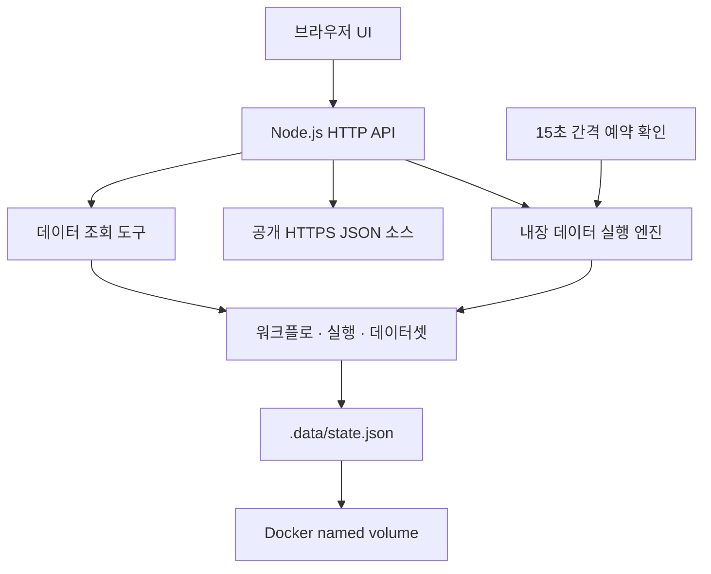
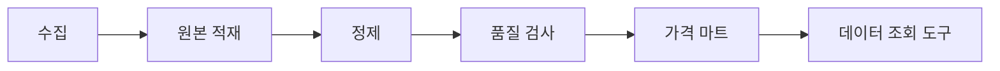

# Tide v0.1의 구조

Tide는 시각적 워크플로, 데이터 처리와 실행 기록을 하나의 로컬 프로세스에 연결한 첫 구현입니다. 브라우저 UI는 작업 정의를 편집하고, Node.js 서버는 내장 실행 엔진을 호출한 뒤 상태를 JSON 파일로 저장합니다.

## 구성 요소



`core/engine.mjs`는 저장소나 HTTP 서버에 의존하지 않는 데이터 처리 모듈입니다. `core/scheduler.mjs`는 예약 설정, 다음 시각과 도래한 예약을 처리합니다. `server/api.mjs`가 외부 입력과 HTTP 수집을 검증합니다. `server/local.mjs`는 API 요청과 예약 실행을 같은 프로세스 안에서 순서대로 처리하고, 임시 파일을 쓴 다음 이름을 바꿔 상태를 갱신합니다. 여러 서버 프로세스가 같은 파일에 쓰는 구성은 지원하지 않습니다.

`public/`의 HTML, CSS와 JavaScript 모듈은 빌드 과정 없이 제공됩니다. `public/schedules.js`는 예약 설정 화면과 실행 캘린더입니다. UI의 드래그 좌표와 노드 설정은 워크플로 정의에 저장됩니다.

## 데이터 처리

지원하는 작업 순서는 다음과 같습니다.



각 작업 유형은 워크플로당 하나만 존재합니다. 수집부터 특정 단계까지 연결한 흐름도 허용하지만, 중간 단계를 건너뛸 수 없습니다. 저장과 실행 전에 순환, 중복 연결, 잘못된 선행 작업을 검사합니다.

수집은 내장 샘플, 업로드한 JSON 배열, 공개 HTTPS JSON API를 지원합니다. HTTP 응답은 배열 또는 `data` 속성의 배열을 사용합니다. API는 1MB 이하, 10,000건 이하만 받습니다.

정제는 `sku`, `name`, `category`, `price`, `previous_price`, `date`를 정규화합니다. 필수 값, 날짜 또는 가격이 유효하지 않은 행은 제외하고, 같은 상품과 날짜의 중복은 마지막 값으로 남깁니다. 품질 검사는 원본 건수 대비 잘못된 행의 비율을 확인합니다. 기본 허용 비율은 10%입니다.

마트는 상품별 최신 날짜의 레코드를 선택하고 `change_percent`를 계산합니다. SQL을 실행하거나 데이터 웨어하우스에 테이블을 만드는 기능은 없습니다. 현재 마트는 저장된 JSON 데이터셋입니다.

## 작업 정의와 실행

| 객체 | 내용 |
| --- | --- |
| Workflow | 이름, 노드 유형·설정·좌표, 연결 목록 |
| Schedule | 워크플로 ID, 주기·시간대·활성화, 다음 실행, 최근 결과 |
| Run | 실행 시각, 트리거, 성공·실패, 단계별 로그·건수, 실행 당시 정의 복사본 |
| Dataset | 원본·정제·마트 레코드, 컬럼 목록, 생성 실행, 상위 데이터셋 |
| Connection | 서비스 유형, 주소, 리전, 실제 테스트 또는 미지원 상태 |

실행 기록은 최근 1,000개를 보관합니다. 실행 상태는 `succeeded` 또는 `failed`입니다. 단계는 `succeeded`, `failed`, `skipped`를 기록합니다. HTTP 수집 실패도 실패한 실행으로 남습니다. 트리거는 수동 `manual`, 예약 `scheduled`, 스케줄 즉시 실행 `schedule-test`를 구분합니다. 예약 실행에는 `scheduleId`와 `scheduledFor`도 기록합니다.

실패한 단계 뒤의 작업은 실행하지 않습니다. 실패 전 만들어진 원본과 정제 데이터는 갱신될 수 있지만, 생성하지 못한 마트는 마지막 성공 결과를 유지합니다. 따라서 서로 다른 계층의 현재 데이터셋이 같은 실행에서 생성됐다고 가정하면 안 됩니다. 각 데이터셋의 `runId`와 `updatedAt`을 확인해야 합니다.

현재 데이터셋 ID는 워크플로와 계층별로 고정됩니다. 재실행은 해당 계층의 현재 값을 교체하므로 테이블이나 레코드가 누적되지 않습니다. 과거 실행의 데이터 전체를 버전별로 저장하지는 않습니다. **다시 실행**은 과거 정의 복사본이 아닌 현재 저장된 정의를 사용합니다.

수동 실행은 요청 안에서 끝나는 동기 처리입니다. 예약 실행은 서버 내부 루프가 같은 실행 함수를 호출합니다. 별도 작업 큐, 분산 실행기, 자동 재시도, 단계 재개와 실행 취소는 없습니다.

## 예약 실행과 캘린더

하나의 워크플로에 여러 독립 스케줄을 등록할 수 있습니다. 주기는 매일 `daily` 또는 선택 요일 `weekly`입니다. 실행 시간은 `HH:mm`이며, 지원 시간대는 `Asia/Seoul`과 `UTC`입니다. 주간 예약의 `daysOfWeek`는 일요일 0부터 토요일 6까지의 정수 배열입니다.

스케줄은 생성·편집·일시정지·재개·삭제와 즉시 실행을 지원합니다. 활성 스케줄에는 UTC ISO 형식의 `nextRunAt`을 저장합니다. 일시정지하면 다음 실행 시각은 `null`이 되고, 재개 시 현재 시각 이후의 다음 예약을 계산합니다. 즉시 실행은 활성화 상태와 다음 예약 시각을 바꾸지 않습니다.

서버는 시작 직후와 15초마다 예약을 확인합니다. 도래한 작업은 API 요청과 같은 직렬 큐에서 실행하므로 정확한 초 단위 시작은 보장하지 않습니다. 컴퓨터나 컨테이너가 중지된 동안은 실행할 수 없습니다. 저장된 다음 시각이 과거라면 재시작 시 스케줄당 한 번 실행하고 미래의 다음 시각으로 이동합니다. 누락된 회차를 각각 재처리하지 않습니다.

실행 전 다음 시각을 먼저 저장하므로, 그 저장과 실제 실행 사이에 서버가 중단되면 해당 회차가 누락될 수 있습니다. 이 구현은 단일 프로세스용이며, 분산 실행이나 정확히 한 번 실행을 보장하지 않습니다. 재시도와 기간 재처리는 별도 확장 항목입니다.

실행 캘린더는 현재 주를 포함한 26주, 182칸을 표시합니다. 실제 저장된 실행을 시작 시각의 `Asia/Seoul` 날짜로 묶으며, 수동·예약·스케줄 즉시 실행을 모두 포함합니다. 날짜별 성공·실패 상태를 보여주고, 날짜를 선택하면 해당 실행의 로그로 이동합니다. 워크플로 필터는 스케줄 목록과 실행 캘린더에 적용합니다.

캘린더는 예약 예정 건수를 실행 성과로 표시하지 않습니다. 최근 1,000개 실행만 남기므로 오래된 칸이 비어 있어도 과거에 실행이 없었다는 뜻은 아닙니다. 브라우저에 표시된 실행 기록은 영구 감사 로그가 아닙니다.

## 메타데이터와 데이터 조회

원본·정제·마트 데이터셋에 저장 위치 대신 논리 ID, 컬럼, 건수와 갱신 시각을 기록합니다. `upstream`은 내장 작업이 만든 데이터셋 관계입니다. 외부 SQL 분석이나 컬럼 단위 추론은 수행하지 않습니다.

데이터 조회 도구는 질문 문자열에서 지원 유형을 선택하고 실제 마트를 계산합니다. 가격 상승·하락, 평균 가격, 상품 수와 카테고리별 요약을 지원합니다. 지원하지 않는 질문은 오류로 응답하며 답을 생성하지 않습니다. 응답에는 데이터셋 ID, 이름, 갱신 시각과 생성 실행을 포함합니다.

UI는 가장 최근에 갱신된 마트를 조회합니다. API는 선택적으로 `workflowId`를 받을 수 있습니다. 대화 내용은 브라우저 메모리에만 있으며 워크스페이스 파일에 저장하지 않습니다. LangGraph 실행 기록, LLM 호출과 문서 검색은 현재 구조에 포함되지 않습니다.

## 클라우드 연결 경계

HTTP 연결 테스트는 주소를 실제 조회하고 JSON 레코드 형식을 검사합니다. AWS, GCP, Azure 설정은 이름과 리전 등을 보관할 뿐 인증하거나 자원을 생성하지 않습니다. 연결 등록과 워크플로 수집 설정은 독립적입니다.

이후 확장할 때는 데이터 소스 커넥터와 작업 실행 어댑터를 나누는 방향을 검토합니다. 현재 별도의 플러그인 인터페이스는 구현하지 않았습니다.

## API

| 메서드와 경로 | 결과 |
| --- | --- |
| `GET /api/state` | 워크플로, 스케줄, 실행, 데이터셋과 연결 |
| `POST /api/workflows` | 새 템플릿 워크플로 생성 |
| `PUT /api/workflows/:id` | 검증 후 작업 정의 저장 |
| `POST /api/workflows/:id/run` | 실행 후 `{run, datasets}` 반환 |
| `POST /api/schedules` | 예약 설정 검증 후 생성 |
| `PUT /api/schedules/:id` | 예약 이름·대상·주기·시간·시간대·활성화 수정 |
| `POST /api/schedules/:id/toggle` | `{enabled: boolean}`으로 일시정지 또는 재개 |
| `POST /api/schedules/:id/run-now` | 다음 예약을 유지하고 즉시 실행, `{run, datasets, schedule}` 반환 |
| `DELETE /api/schedules/:id` | 예약 삭제, 과거 실행 기록 유지 |
| `POST /api/chat` | `{question, workflowId?}`를 받아 실제 데이터 조회 |
| `POST /api/connections` | 비밀 정보 없이 연결 설정 생성 |
| `POST /api/connections/:id/test` | HTTP 실제 조회 또는 미지원 상태 기록 |
| `GET /api/export` | 현재 워크스페이스 JSON 다운로드 |

JSON 요청은 `Content-Type: application/json`을 사용합니다. 오류 응답은 `{ "error": "설명" }`입니다. 데이터 처리 실패는 유효한 실행 결과이므로 HTTP 200과 `run.status: "failed"`로 구분합니다. 요청 형식 오류는 400, 요청 크기 초과는 413, 없는 경로는 404입니다.

예약 생성 본문은 다음 형식입니다.

```json
{
  "name": "평일 아침 가격 갱신",
  "workflowId": "wf-commerce",
  "frequency": "weekly",
  "time": "09:00",
  "daysOfWeek": [1, 2, 3, 4, 5],
  "timezone": "Asia/Seoul",
  "enabled": true
}
```

예약 ID, 다음 실행 시각과 최근 실행 결과는 서버가 관리합니다. 편집 요청은 이러한 시스템 필드를 덮어쓰지 않습니다.

## 실행과 보관

Docker 컨테이너는 비루트 사용자로 실행됩니다. 호스트의 기본 주소는 `127.0.0.1:4318`이고, 컨테이너는 `/app/.data`에 상태를 기록합니다. `/api/state` 응답으로 상태 검사를 수행합니다.

작업 공간에는 인증과 사용자별 권한이 없습니다. 로컬 단일 사용 범위와 비밀 정보 취급은 [보안 문서](../SECURITY.md)를 확인하세요.
